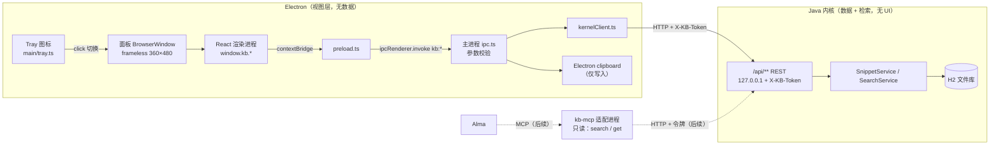

# MVP 第 5 步设计：菜单栏面板 + 知识库数据模型

> 日期：2026-11-01 · 状态：待确认 · 前置：第 3–4 步（Electron ↔ Java 本地 HTTP + 令牌）已完成
> 关联：`docs/mvp-design.md`（第 5 步「片段列表、搜索框、新增 / 编辑表单」）

## 1. 背景与定位

产品从「代码片段管理器」放宽为**个人知识库**：代码、随手笔记、（后续）剪贴板摘录共用一套数据和检索。同一份数据有两类使用者：

- **我自己**：macOS 顶部菜单栏点图标 → 紧凑面板 → 搜、复制、走。重在「快速取回」，不是「管理整理」。
- **Alma（AI 助手，后续）**：通过独立的 MCP 适配进程调用 Java 内核 HTTP，检索我的知识库当上下文。

边界不变：**Electron 不管数据、Java 不管 UI**。

## 2. 目标 / 非目标

**目标（第 5 步交付）**

1. Tray 图标 + 无边框弹出面板（约 360×480），锚定在图标下方，失焦隐藏。
2. 渲染层改为 React（Vite 打包），替换现有联调页。
3. 面板功能：搜索、最近 / 结果列表、按类型筛选、新建、编辑（标题 / 正文 / 标签 / 类型）、删除（二次确认）、一键复制正文。
4. Java：片段新增 `kind`、`source` 字段，向后兼容；列表与搜索支持可选 `kind` 过滤。
5. 补全 IPC 与 `kernelClient`（get / list / update / delete / copy / hide）。
6. README 中 HTTP API 文档更新为稳定契约，作为 Alma 适配层的依据。
7. 面板预留「最近复制」区域（占位，不实现）。

**非目标（明确不做）**

- 语法高亮、全局快捷键（第 6 步）、剪贴板监听（第 7 步）、插件系统（第 8–9 步）。
- MCP 适配层本身、只读令牌、对外连接文件（只描述扩展点，见 §8）。
- 打包签名、`LSUIElement` 等发布配置（第 10 步）。
- 多窗口 / 完整主窗口、主题定制、Markdown 渲染。

## 3. 架构



要点：

- 渲染进程**不直连**内核（无 CORS、不知道令牌）；一律 `window.kb` → IPC → 主进程 → HTTP。
- 主进程只做转发、参数校验、窗口与剪贴板这类系统能力，不缓存业务数据。
- Alma 走另一条路，直接打 HTTP，不经过 Electron；因此 HTTP API 是**对外契约**，IPC 是**内部契约**。

## 4. 数据模型变更（Java）

新增两列：

| 字段 | 类型 | 取值 | 默认 | 说明 |
| --- | --- | --- | --- | --- |
| `kind` | `VARCHAR(16) NOT NULL` | `CODE` / `NOTE` / `CLIP` | `NOTE` | 内容类型，用于筛选与图标 |
| `source` | `VARCHAR(16) NOT NULL` | `MANUAL` / `CLIPBOARD` / `ALMA` | `MANUAL` | 来源，创建时确定 |

- Java 用枚举 `SnippetKind`、`SnippetSource`，JPA `@Enumerated(EnumType.STRING)`。
- **迁移**：`schema.sql` 的建表语句加上两列；另追加幂等语句，兼容已有库文件：
  ```sql
  ALTER TABLE snippet ADD COLUMN IF NOT EXISTS kind   VARCHAR(16) DEFAULT 'NOTE'   NOT NULL;
  ALTER TABLE snippet ADD COLUMN IF NOT EXISTS source VARCHAR(16) DEFAULT 'MANUAL' NOT NULL;
  CREATE INDEX IF NOT EXISTS idx_snippet_kind ON snippet (kind);
  ```
  仍保持 `ddl-auto=validate`，不引入 Flyway（MVP 够用，表多了再换）。
- 旧数据自动得到 `NOTE / MANUAL`。

## 5. HTTP API 变更（向后兼容）

| 接口 | 变更 |
| --- | --- |
| `POST /api/snippets` | 请求体新增可选 `kind`、`source`；缺省为 `NOTE`、`MANUAL` |
| `PUT /api/snippets/{id}` | 新增可选 `kind`：**缺省时保留原值**（老客户端不会把类型冲掉）；`source` 被忽略（来源不可改） |
| `GET /api/snippets/{id}`、列表、搜索结果 | 响应体新增 `kind`、`source` |
| `GET /api/snippets?page&size&kind=` | 新增可选 `kind` 过滤，面板「最近」列表用 |
| `GET /api/snippets/search?q&limit&kind=` | 新增可选 `kind` 过滤；`SearchService.search(query, limit, kind)`，`kind` 为空表示不过滤 |

- 非法枚举值 → `400`，`error=BAD_REQUEST`（由 `GlobalExceptionHandler` 统一处理类型转换 / 反序列化失败，`message` 列出合法值）。
- 打分规则不变，`kind` 只是额外的 `AND` 条件。
- README 的 API 表补齐字段与示例，并标注：**`/api/**` 为稳定契约，破坏性修改需升版本并更新 README**。

请求示例：

```json
{ "title": "Docker 清理", "content": "docker system prune -af", "tags": ["docker"], "kind": "CODE" }
```

## 6. IPC 变更（Electron 内部契约）

`window.kb`（preload 暴露，类型定义共享给 React）：

| 方法 | IPC 通道 | 对应 HTTP / 能力 |
| --- | --- | --- |
| `health()` | `kb:health` | 已有 |
| `meta()` | `kb:meta` | 已有 |
| `search(q, { kind?, limit? })` | `kb:search` | 签名调整：第二参数改为选项对象 |
| `listSnippets({ page?, size?, kind? })` | `kb:listSnippets` | `GET /api/snippets` |
| `getSnippet(id)` | `kb:getSnippet` | `GET /api/snippets/{id}` |
| `createSnippet(body)` | `kb:createSnippet` | 已有，body 支持 `kind` |
| `updateSnippet(id, body)` | `kb:updateSnippet` | `PUT` |
| `deleteSnippet(id)` | `kb:deleteSnippet` | `DELETE` |
| `copyText(text)` | `kb:copyText` | 主进程 `clipboard.writeText`（不入库） |
| `hidePanel()` | `kb:hidePanel` | 隐藏面板（Esc / 复制后） |

- 主进程把 IPC 注册从 `main.ts` 拆到 `main/ipc.ts`；每个 handler 做最小参数校验（id 为正整数、kind 在枚举内、字符串长度上限），非法参数直接拒绝，不打 HTTP。
- `KernelHttpError` 序列化为 `{ status, error, message }` 传回渲染层，React 统一显示错误条。
- 校验 IPC 发送方：只接受来自面板 `webContents` 的调用。

## 7. 面板窗口与 React 结构

### 7.1 窗口（`main/tray.ts`、`main/panel.ts`）

- macOS：`app.dock.hide()`，只留菜单栏图标（模板图 `trayTemplate.png` 16pt + @2x，自动适配深浅色）。
- `BrowserWindow`：`frame:false`、`resizable:false`、`show:false`、`skipTaskbar:true`、`fullscreenable:false`、`alwaysOnTop:true`；`contextIsolation:true`、`nodeIntegration:false`、`sandbox:true`（preload 只用 `contextBridge` / `ipcRenderer`，可开沙箱）。
- 点击 Tray：可见则隐藏，否则按 `tray.getBounds()` 计算位置后 `show()` + `focus()`。位置计算抽成纯函数 `computePanelPosition(trayBounds, panelSize, workArea)`：水平居中于图标、贴图标下沿、夹在屏幕工作区内。
- `blur` → 隐藏；开发时可用环境变量 `KB_PANEL_PIN=1` 关闭失焦隐藏，方便调试 DevTools。
- Tray 右键菜单：「打开面板」「退出」。退出仍走现有 `before-quit` → `kernel.stop()`。
- 非 macOS（含盒子上的 Linux 开发）：同一套代码，Tray 点击行为可能不同，兜底在右键菜单里放「打开面板」。
- `index.html` 加 CSP：`default-src 'self'; script-src 'self'; style-src 'self' 'unsafe-inline'`，禁止外部网络。

### 7.2 构建

- 主进程 / preload：保持 `tsc`（CommonJS）。
- 渲染层：Vite + `@vitejs/plugin-react`，`src/renderer` 为 root，产物 `dist/renderer`，`base: './'` 以支持 `loadFile`。替换 `scripts/copy-renderer.mjs`。
- `npm run build` = `tsc -p tsconfig.json && vite build`；开发可选 `vite` dev server（`KB_RENDERER_URL`），默认仍加载本地文件。
- 渲染层单独 `tsconfig.renderer.json`（`jsx: react-jsx`、`module: ESNext`、`lib: DOM`）。
- 新依赖：`react`、`react-dom`、`vite`、`@vitejs/plugin-react`、`@types/react*`；测试 `vitest`、`@testing-library/react`、`jsdom`。不引入路由、状态库、UI 组件库。

### 7.3 组件

```
src/renderer/
  main.tsx                 入口
  App.tsx                  视图状态：{ mode: 'list' } | { mode: 'edit', id?: number }
  api/kb.ts                window.kb 的类型化封装 + 错误归一
  hooks/useDebounced.ts    搜索输入防抖（200ms）
  hooks/useSnippets.ts     q 为空 → listSnippets（最近 20 条）；否则 search；带 kind 过滤
  components/
    SearchBar.tsx          自动聚焦；Esc 清空 / 再按隐藏面板；↑↓ 选择，Enter 复制
    KindFilter.tsx         全部 / 代码 / 笔记 / 摘录
    SnippetList.tsx        结果或最近列表
    SnippetItem.tsx        标题、类型图标、标签、正文首行；复制 / 编辑按钮
    SnippetEditor.tsx      新建 / 编辑：标题、正文（textarea 等宽）、标签（逗号分隔）、类型；保存 / 删除 / 返回
    ConfirmDelete.tsx      删除二次确认（行内）
    RecentCopies.tsx       第 7 步占位：折叠区「最近复制」，当前显示“即将推出”
    ErrorBanner.tsx        内核错误 / 断连提示
  styles.css               系统字体，跟随 prefers-color-scheme
```

布局（自上而下）：搜索框 + 「＋」→ 类型筛选 → 列表（占主体）→ 折叠的「最近复制」占位 → 底部状态栏（内核状态）。

行为约定：

- 每次面板显示时：聚焦搜索框并刷新列表（主进程发 `kb:panelShown` 事件，preload 暴露 `onPanelShown(cb)`）。
- 复制成功后短暂提示「已复制」，然后隐藏面板。
- 编辑页保存成功回到列表并刷新；校验错误（`fieldErrors`）显示在对应字段下。

## 8. Alma 扩展点（本步只预留，不实现）

- 形态：独立进程 `kb-mcp`（后续可放在 `adapters/mcp/`），把内核 HTTP 包装成 MCP 工具，首批只读：`search_snippets(q, kind?, limit?)`、`get_snippet(id)`；以后再考虑 `create_snippet`（写入时 `source=ALMA`）。
- 它只依赖 §5 的 HTTP 契约，不依赖 Electron、IPC 或 React。第 5 步需要保证的就是：字段稳定、README 有完整文档、`source` 枚举里已有 `ALMA`。
- **待解决的接入问题**（第 5 步不做，见开放问题）：
  1. 当前端口随机（`KB_PORT=0`）、令牌只存在 Electron 内存里，外部进程拿不到。需要一种发现方式，例如 Electron 写一个仅本人可读（0600）的连接文件。
  2. 现有令牌是全权限。给 AI 用应当有单独的**只读令牌**（内核侧对非 GET 请求拒绝）。

## 9. 剪贴板预留（第 7 步）

- 面板中 `RecentCopies` 区域位置和折叠交互在本步定好，内容为空占位。
- 第 7 步方案（已确认）：主进程监听剪贴板 → 内存中的临时列表（有过期时间、条数上限，不落盘）→ 跳过疑似密钥 / 令牌 / 验证码的内容 → 我点「保存」才调用 `createSnippet({ kind: 'CLIP', source: 'CLIPBOARD' })`。
- 临时列表属于 UI 状态，放 Electron 主进程内存；**入库**的数据才归 Java 管，不违背边界。

## 10. 测试方案

**Java（`./mvnw test`）**

- `SnippetServiceTest`：缺省 `kind/source` 为 `NOTE/MANUAL`；`PUT` 不传 `kind` 时保留原值；`source` 不可被更新。
- `SnippetControllerTest`：响应含新字段；非法枚举 → 400 `BAD_REQUEST`；列表与搜索的 `kind` 过滤。
- `LikeSearchServiceTest`：`kind` 过滤与原打分 / 排序并存。
- 迁移测试：用只有旧列的表结构初始化库，再启动上下文，确认两列被补上且旧行取默认值。

**Electron（`npm test`）**

- `kernelClient.test.ts`：新方法的 URL、方法、请求体、`kind` 参数编码、错误映射（fake fetch）。
- `ipc` 参数校验：纯函数单测（非法 id / kind / 超长字符串被拒）。
- `computePanelPosition`：图标在屏幕中间 / 贴右边缘 / 多显示器偏移。
- React（vitest + Testing Library + jsdom，mock `window.kb`）：空查询走 list、输入走 search（防抖）、类型筛选传参、复制调用 `copyText`、编辑保存 / 删除确认、错误条显示。

**手动冒烟（需要在 Mac 上跑，盒子是 Linux）**：菜单栏图标出现、点击弹出位置正确、失焦隐藏、增删改查与复制、退出后 Java 进程被结束、深浅色模式。

## 11. 风险

| 风险 | 应对 |
| --- | --- |
| 盒子是 Linux，Tray / 失焦 / 定位行为与 macOS 不同，无法在盒子上验收 UI | 逻辑抽成可单测的纯函数；UI 冒烟必须在你的 Mac 上做 |
| 无边框 + 失焦隐藏导致调试困难、弹出确认框时意外关闭 | `KB_PANEL_PIN=1`；删除确认做成行内而非原生对话框 |
| `schema.sql` 用 `ALTER ... IF NOT EXISTS` 做迁移，后续表结构变多会乱 | 本步够用；字段再增加时改用 Flyway |
| 引入 Vite / React 后构建链变复杂 | 主进程仍是 tsc；渲染层单独配置，`npm run build` 一条命令 |
| `kb:search` 签名变更 | 唯一调用方是本步要替换的联调页，同步修改 |
| `PUT` 对 `kind` 采用“缺省保留”，与“全量更新”语义不一致 | 在 README 写明；`title/content/tags` 仍全量 |
| 后续给 Alma 开放时泄露全权限令牌 | §8 只读令牌方案，开放前必须先做 |

## 12. 开放问题

1. 旧数据和未指定类型的新建条目默认 `NOTE` 还是 `CODE`？（本文暂定 `NOTE`；现有库里基本是联调数据。）
2. 菜单栏图标用什么形状？（暂用简单的书本 / 方块模板图，后续可换。）
3. Alma 的接入方式需要确认它确实支持 MCP；以及连接文件 + 只读令牌放在哪一步做（建议放在面板之后、插件系统之前单独一步）。
